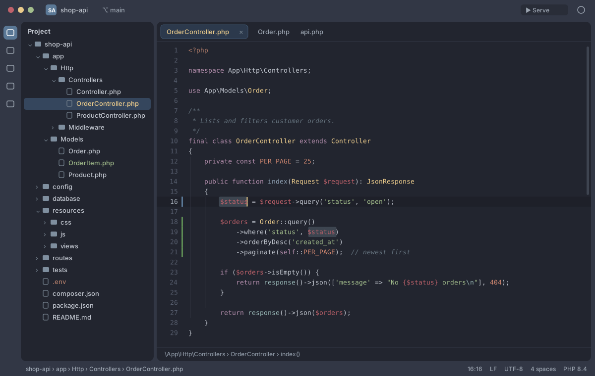
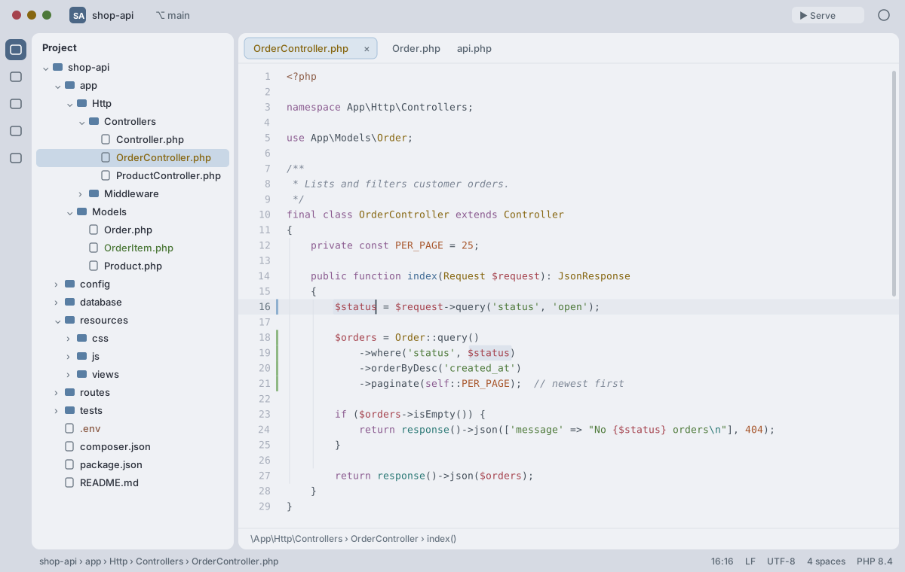
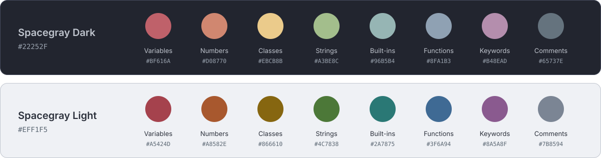

# Spacegray Dark/Light Theme

**A calm, low-contrast theme for PhpStorm and every other JetBrains IDE.** 
Full UI theme and editor color scheme, in dark and light.

[Installation](#installation) · [Palette](#palette) · [Supported languages](#supported-languages) · [Changelog](CHANGELOG.md)

 

  

  

## Why Spacegray

Spacegray started in 2015 as a single color scheme file for PhpStorm. Version 2 is a rewrite as a proper plugin.

- **Two variants.** Spacegray Dark keeps the original blue-gray look. Spacegray Light uses the same hues, darkened so they stay readable on a light background.
- **The whole IDE, not only the editor.** Tool windows, tabs, popups, menus, dialogs and the status bar all follow the theme.
- **Easy on the eyes.** Muted colors, soft contrast, no neon.
- **One-click install.** Available from JetBrains Marketplace, no files to copy.

## Installation

Requires IDE version **2025.3 or newer**.

1. Open <kbd>Settings</kbd> → <kbd>Plugins</kbd> → <kbd>Marketplace</kbd>.
2. Search for **Spacegray Dark/Light Theme** and click <kbd>Install</kbd>.
3. Go to <kbd>Settings</kbd> → <kbd>Appearance & Behavior</kbd> → <kbd>Appearance</kbd> → <kbd>Theme</kbd> and pick **Spacegray Dark** or **Spacegray Light**.

<b>Install from a file</b>

 

Download the latest ZIP from [Releases](https://github.com/yunusekim/phpstorm-spacegray-dark-theme/releases), then open <kbd>Settings</kbd> → <kbd>Plugins</kbd> → <kbd>⚙</kbd> → <kbd>Install Plugin from Disk…</kbd> and select it.

<b>Older IDE versions</b>

 

The original 2015 color scheme is still here: [`legacy/Spacegray-Dark.icls`](legacy/Spacegray-Dark.icls).

Import it via <kbd>Settings</kbd> → <kbd>Editor</kbd> → <kbd>Color Scheme</kbd> → <kbd>⚙</kbd> → <kbd>Import Scheme…</kbd>. It colors the editor only.

## Palette

Based on [Base16 Ocean](https://github.com/chriskempson/base16).

  

## Supported languages

Any language your IDE supports gets themed. These have dedicated colors:

| | |
|---|---|
| **PHP** | variables, named arguments, heredoc, PHPDoc |
| **HTML / XML** | tags, attributes, entities |
| **CSS / Sass / Less** | selectors, properties, variables, mixins |
| **JavaScript / TypeScript** | functions, parameters, regex, JSX |
| **JSON / YAML** | keys and values |
| **SQL** | tables, columns, procedures |
| **Markdown** | headings, emphasis, code, links |

Diffs, VCS status, inspections, search results, inlay hints, the debugger and the console use the same palette.

## Supported IDEs

PhpStorm · WebStorm · IntelliJ IDEA · PyCharm · GoLand · RubyMine · CLion · Rider · DataGrip · RustRover · Android Studio

Theme files live in [`src/main/resources/themes`](src/main/resources/themes).

## Contributing

Found a color that looks off? [Open an issue](https://github.com/yunusekim/phpstorm-spacegray-dark-theme/issues) with a screenshot and the language you were using. Pull requests are welcome.

## License

[MIT](LICENSE) © Yunus Ekim
